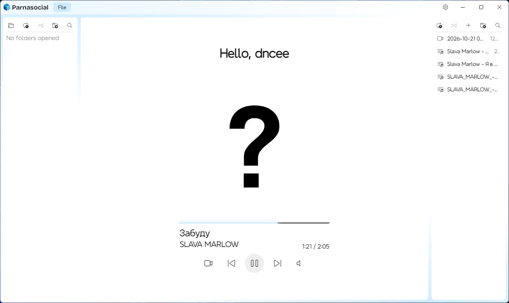

# Parnasocial

A Windows desktop media player project in early development.

The goal is a local-first player: no account, no cloud, no telemetry. The current state is an interface prototype. Media playback, folder scanning, playlist management, and full settings are not implemented yet.

## Platform

Windows only. The application targets `win32` and `x64`. The main process exits immediately when launched on another platform.

[Linux and mac](https://github.com/vexikoff/parnasocial-mac-linux/)

## Tech stack

- Electron as the desktop shell.
- Plain HTML, CSS, and JavaScript for the renderer.
- Preload bridge with context isolation and sandbox enabled.
- `localStorage` for client-side preferences such as theme.
- `electron-builder` for packaging Windows NSIS installer and portable executable.

## Current interface

The window uses a frameless layout with native Windows controls overlay. The overlay height is 36 pixels and should match the custom header height.

The interface currently contains:

- Header with application icon, title, and settings button.
- Left panel with folder/search action buttons.
- Center player area with greeting, track placeholder, transport buttons, and volume slider.
- Right panel with playlist action buttons.
- Settings panel that can be toggled visually.

Most media controls are placeholders until playback logic is added.

## Project layout

    parnasocial/
        .gitignore
        CONTRIBUTING.md
        LICENSE
        README.md
        main.js
        preload.js
        package.json
        package-lock.json
        assets/
            Bricolage_Grotesque/
            DM_Sans/
            Xmind/
            icon.png
            Parnasocial.ico
            Parnasocial.png
            Parnasocial.svg
            Parnasocial_mini.png
            Parnasocial_mini16.png
            Parnasocial_mini18.png
            pre.png
            style.css
            style.css.map
            style.scss
            fullscreen.css
            fullscreen.css.map
            fullscreen.scss
            unknown.png
            unknowndark.png
        electron/
        public/
            index.html
            script.js
            fullscreen.html
            fullscreen.js

`node_modules` and IDE folders are not part of the source layout.

## Run from source

Requirements:

- Node.js 20 or newer.
- npm 10 or newer.

  npm install
  npm start

## Build for Windows

    npm run dist

The build output is placed in:

    release/<version>/

The Windows build produces:

- NSIS installer.
- Portable executable.

Both use:

    assets/Parnasocial.ico

for application, installer, and uninstaller icons.

## Renderer bridge

The preload script exposes a limited `window.parnasocial` API to the renderer.

Available bridge areas:

- `app.getInfo()` returns basic application and runtime information.
- `window.minimize()`, `window.toggleMaximize()`, `window.close()`, `window.isMaximized()`, and `window.onMaximized()` control or observe the main window.
- `getWindowsUsername()` returns the current Windows username for the greeting text.
- `changeth()` sends a theme change event to the main process.

Native title bar overlay theme synchronization is not finished yet.

## Theme

The renderer stores a theme flag in `localStorage` under the key `yaebalneironki`.

Accepted values:

- `0` for light theme.
- `1` for dark theme.

The value is applied to the document root through the `data-theme` attribute.

Theme handling is still incomplete and should not be treated as final.

## Security model

The current Electron configuration uses conservative defaults:

- `contextIsolation: true`
- `nodeIntegration: false`
- `sandbox: true`
- `webSecurity: true`
- `allowRunningInsecureContent: false`
- `experimentalFeatures: false`
- DevTools are disabled in packaged builds.
- New window creation is denied.
- Navigation away from the current page is blocked.
- WebView attachment is blocked.
- Permission requests are limited to clipboard access.

No remote content loading is configured in the current renderer.

## Known limitations

- Media playback is not implemented.
- Folder buttons do not open or scan folders yet.
- Playlist buttons do not manage playlists yet.
- Volume slider is visual only.
- Settings panel is only toggled visually.
- Theme synchronization with the native Windows title bar overlay is incomplete.
- The project is Windows-only.

## Contributing

This is an early project. Small fixes, documentation, UI polish, translations, bug reports, and reproduction steps are the most useful contributions right now.

For larger changes, open an issue first and discuss the approach before submitting a pull request.

## License

This project is licensed under the MIT License. See the `LICENSE` file for details.

Maintainer: vexikoff.

Greet.

